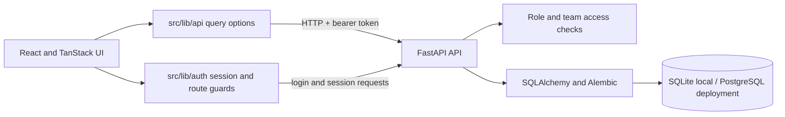

# Newtonite Operations Command Center

An enterprise-style workspace for coordinating operational work, approvals, team capacity, and audit activity. It combines a React and TanStack interface with a role-aware FastAPI service and a relational data model built for versioned, concurrency-safe workflows.

**[Open the live command center](https://newtonite-operations-command-center.vercel.app)** · [API health](https://newtonite-operations-api.vercel.app/health) · [Interactive API docs](https://newtonite-operations-api.vercel.app/docs)

The hosted workspace uses a persistent PostgreSQL database and synthetic demo records. You can sign in with one of the [demo accounts](#hosted-demo-login-credentials); their shared password is listed there. Demo data is shared and may be changed by other visitors.

### Quick start

For a complete local setup, follow [Run locally](#run-locally). In brief, start the FastAPI backend in one terminal and the Vite frontend in another, then open `http://localhost:5173`.

- **Backend:** Python 3.11+, SQLite for local data, and the setup commands below.
- **Frontend:** Node.js `^20.19.0` or `>=22.12.0`.
- **Local sign-in:** choose a password for the seeded demo accounts with `NEWTONITE_DEMO_PASSWORD`; local passwords are separate from the hosted demo password.

## Contents

- [What it does](#what-it-does)
- [Quick start](#quick-start)
- [Architecture](#architecture)
- [Access and workflow model](#access-and-workflow-model)
- [Run locally](#run-locally)
- [Demo dataset](#demo-dataset)
- [API overview](#api-overview)
- [Checks](#checks)
- [Deployment](#deployment)
- [Project layout](#project-layout)
- [Security and known boundaries](#security-and-known-boundaries)
- [Engineering notes](#engineering-notes)

## What it does

- **Operations dashboard:** authorized workload, capacity, due-date risk, throughput, and recent activity.
- **Operations Network:** lazy-loaded 3D team topology with a 2D fallback when WebGL is unavailable. Team placement is illustrative, not geographic.
- **Work-item command board:** team-scoped queues with filtering, sorting, priority and due-date indicators, item history, claims, and version-aware edits.
- **Approval queue:** eligible `in_review` work items with guarded manager/admin approval actions.
- **Team coverage:** membership, capacity, workload, overdue, and bottleneck indicators.
- **Activity audit:** team-scoped event history with actor, category, timestamp, and event ID filters.
- **Secure sign-in:** API-issued short-lived bearer tokens; the backend checks current user status, team membership, and role on protected requests.
- **Responsive interface:** designed for desktop operations views and smaller screens, with accessible form states and reduced-motion support.

## Architecture



UI components consume data through `src/lib/api/*` query options. This keeps the UI independent of whether the API is backed by local SQLite or a deployed PostgreSQL database. Authentication, membership scoping, workflow validation, and writes are enforced by the backend.

## Access and workflow model

Roles are assigned per team membership. Every protected API request checks the active account and the requested team's membership.

| Role | Read team data | Work-item writes | Approve `in_review` work |
| --- | --- | --- | --- |
| Admin | Yes | Yes | Yes |
| Manager | Yes | Yes | Yes |
| Member | Yes | Yes | No |
| Viewer | Yes | No | No |

The work-item workflow is `open → in_progress → in_review → done`, with supported transitions to and from `blocked` as documented by the API. Updates carry an `expected_version`; claims use a conditional database update; create requests carry an idempotency key. Successful item changes and their activity events are committed together. Stale edits, invalid transitions, duplicate claims, and conflicting idempotency keys return conflict errors instead of silently overwriting data.

## Run locally

### Requirements

- Node.js `^20.19.0` or `>=22.12.0`
- Python 3.11+
- PowerShell examples below; adapt activation and environment-variable commands for your shell

### 1. Start the API

In a PowerShell window:

```powershell
cd backend
py -3.11 -m venv .venv
.\.venv\Scripts\Activate.ps1
python -m pip install -e ".[test]"
if (!(Test-Path .env)) { Copy-Item .env.example .env }
$env:APP_ENV = "development"
$env:DATABASE_URL = "sqlite:///./newtonite.db"
$env:JWT_SECRET_KEY = (py -c "import secrets; print(secrets.token_urlsafe(48))")
$env:CORS_ORIGINS = "http://localhost:5173"
$seedPassword = Read-Host "Set a local demo password (12+ characters)" -AsSecureString
$env:NEWTONITE_DEMO_PASSWORD = [System.Net.NetworkCredential]::new("", $seedPassword).Password
alembic upgrade head
python -m app.dev_seed
python -m uvicorn app.main:app --reload --port 8000
```

Set `NEWTONITE_DEMO_PASSWORD` to a local password of at least 12 characters before the first seed, as shown above. If it is unset on a fresh database, the seed generates and prints a one-time password. Keep it private. Existing account passwords are preserved on reruns unless the variable is explicitly set. The seed is restricted to development with SQLite; it refuses other configurations.

### 2. Start the frontend

In a second PowerShell window, from the repository root:

```powershell
if (!(Test-Path .env.local)) { Copy-Item .env.example .env.local }
npm install
npm run dev -- --host localhost --port 5173
```

Visit [http://localhost:5173](http://localhost:5173). The root `.env.example` points `VITE_API_BASE_URL` at `http://localhost:8000`. Do not put secrets in frontend environment variables; Vite variables are exposed to the browser bundle.

Keep the API terminal running while using the frontend. To sign in locally, use one of the role IDs in [Local demo sign-in](#local-demo-sign-in) and the password you set before running the seed command.

## Demo dataset

`python -m app.dev_seed` generates deterministic, synthetic development data: seven operational teams, 78 synthetic accounts, 350 work items (50 per team), and 1,050 generated activity events. It is intended for local evaluation and is not real company or customer data. It refuses to seed production or a non-SQLite database.

### Hosted demo login credentials

Open the [live demo login page](https://newtonite-operations-command-center.vercel.app/login). Enter the email shown under **Login ID** in the email field and the value under **Password** in the password field. These are public credentials for synthetic demo accounts; the hosted workspace data is for demonstration and may be changed by other visitors.

| Role | Login ID (email field) | Password (password field) | Team access |
| --- | --- | --- | --- |
| Manager | `newtonite-demo@example.com` | `puhCAtG5fWRolIYzJteVGp4d3Xn-NOaC` | All seven teams |
| Member | `member-demo@example.com` | `puhCAtG5fWRolIYzJteVGp4d3Xn-NOaC` | Logistics Control |
| Viewer | `viewer-demo@example.com` | `puhCAtG5fWRolIYzJteVGp4d3Xn-NOaC` | Compliance |
| Admin | `admin-demo@example.com` | `puhCAtG5fWRolIYzJteVGp4d3Xn-NOaC` | Platform Reliability |

All four hosted demo accounts currently share the password listed above. Treat these as demo-only credentials; do not reuse this password for any personal or production account.

### Local demo sign-in

For locally seeded accounts, the four email IDs are the same as in the table above, but the password is set independently for your local database. Set `NEWTONITE_DEMO_PASSWORD` before the first seed (12 or more characters), as shown in [Run locally](#1-start-the-api). If you leave it unset on an empty database, the seed creates a random password and prints it once; save it securely because it cannot be recovered from the database. On later seed runs, existing passwords are preserved unless you explicitly set `NEWTONITE_DEMO_PASSWORD` to rotate them. Treat local seeded data as disposable.

## API overview

All protected endpoints use `Authorization: Bearer <token>`. See [backend/README.md](backend/README.md) for request and response details, error codes, authorization rules, and PostgreSQL integration verification.

| Area | Routes |
| --- | --- |
| Health and identity | `GET /health`, `POST /auth/login`, `GET /auth/me` |
| Dashboard and teams | `GET /dashboard`, `GET /teams`, `GET /teams/{team_id}/members` |
| Work items | `GET/POST /teams/{team_id}/work-items`, `GET/PATCH /teams/{team_id}/work-items/{item_id}`, `POST .../claim` |
| Approvals | `GET /teams/{team_id}/approvals`, `POST /teams/{team_id}/approvals/{item_id}/approve` |
| Activity | `GET /teams/{team_id}/activity` |

Mutating work-item routes use version checks and/or idempotency protections as appropriate. Approval status changes and their audit event are transactional.

## Checks

From the repository root:

```powershell
npx tsc --noEmit
npm test
npm run lint
npm run build
```

From `backend/`:

```powershell
python -m pytest -v
```

The regular backend suite uses SQLite. PostgreSQL concurrency behavior is only verified when the PostgreSQL integration test is configured and run against a disposable PostgreSQL database; see [PostgreSQL integration verification](backend/README.md#postgresql-integration-verification).

## Deployment

The live frontend and API are deployed as separate Vercel projects. Configure the frontend's `VITE_API_BASE_URL` to the public API origin. Configure the API with a persistent PostgreSQL `DATABASE_URL`, a strong private `JWT_SECRET_KEY`, and `CORS_ORIGINS` containing the exact deployed frontend origin(s). Apply Alembic migrations before serving traffic. Use the one-time, empty-database production demo bootstrap documented in [backend/README.md](backend/README.md); never run the development seed against production data.

The FastAPI service is deployed from `backend/` with Vercel's Python runtime. Verify `/health` and a demo sign-in after deployments; a successful frontend build alone does not prove that API-backed workflows are operational.

## Project layout

```text
backend/                  FastAPI service, models, migrations, and backend tests
src/components/           Shared UI, dashboard widgets, and operations network
src/lib/api/              API client, schemas, and TanStack Query options
src/lib/auth/             Login, session restoration, expiry, and route access
src/lib/ops/              Workflow filtering, sorting, risk, and transitions
src/routes/               Login, dashboard, work items, approvals, teams, activity
src/test/                 Frontend API and route interaction tests
ENGINEERING_DECISIONS.md  Security, access, and concurrency decisions
```

## Security and known boundaries

- The browser stores its short-lived bearer token in `sessionStorage`. JavaScript executing on the same origin can access it. Production deployments should use a reviewed Content Security Policy and evaluate an HttpOnly, Secure, SameSite cookie or backend-for-frontend session design.
- The backend is the authorization boundary; frontend route guards improve navigation but do not replace API checks.
- The API currently provides throughput as a global series, not per-team history. Network positions are illustrative and are not site coordinates.
- The approval resource represents `in_review` items; there is no separate approval table or blocked-approval endpoint.
- The seeded status snapshot is synthetic demonstration data, not live operational telemetry.

## Engineering notes

See [ENGINEERING_DECISIONS.md](ENGINEERING_DECISIONS.md) for the design record covering role and team scoping, versioned updates, atomic claims, idempotent creates, transactional activity records, and the authentication contract.
